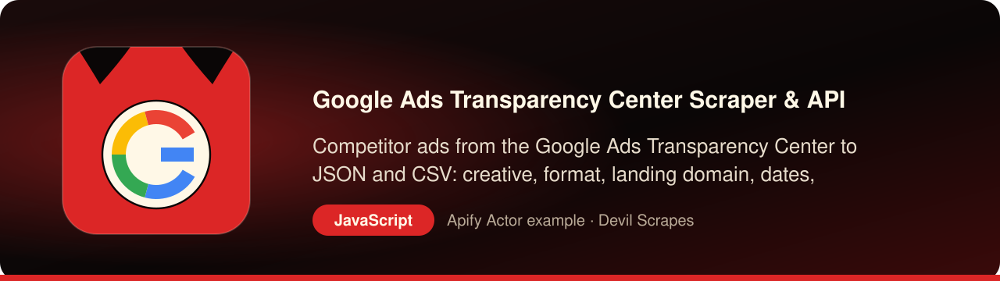

<p align="center"><a href="https://apify.com/DevilScrapes/google-ads-transparency"></a></p>

# Google Ads Transparency Center Scraper for JavaScript and Node.js: competitor ads to JSON and CSV

<p align="center">
<a href="https://apify.com/DevilScrapes/google-ads-transparency"></a>

<a href="LICENSE"></a>
<a href="https://github.com/devilscrapes/google-ads-transparency-scraper-javascript/actions/workflows/ci.yml"></a>
</p>

Use this repository when a Node.js service, script or serverless job needs to know which ads a company runs on Google. A single ES module wraps the official `apify-client` package and calls the **[Google Ads Transparency Center Scraper](https://apify.com/DevilScrapes/google-ads-transparency)**. Supply a brand domain or an advertiser ID and you receive each ad creative as a plain object: advertiser, creative ID, format, destination domain, first and last dates and the impression count Google gives. Apify performs the collection remotely, so there is nothing to host or maintain on your side. Results are written to `results.json` and `results.csv`, or you can lift the client call into your own application and keep the objects in memory.

> **Actor:** [Google Ads Transparency Center Scraper & API](https://apify.com/DevilScrapes/google-ads-transparency) · **Publisher:** [Devil Scrapes](https://apify.com/DevilScrapes) · **Also in Python:** [google-ads-transparency-scraper-python](https://github.com/devilscrapes/google-ads-transparency-scraper-python)

## 🔥 What you get

- **One row per ad creative**, naming the advertiser, the creative ID, a link back to the ad, the domain it sends people to, and a format code for text, image or video.
- **Lifetime of every ad**: Unix timestamps for the first and the last impression Google logged, plus the impression count Google reports where it publishes one.
- **Domains or advertiser IDs**: look up a brand by the site its ads point to, or by the exact advertiser ID when you already have it, and mix both in one call.
- **A shared ad is saved once**: when two of your targets surface the same creative, the dataset holds one copy and the bill counts one.
- **Screening switch**: flip one boolean to get a single summary row per domain (any ads, how many, since when) for checking a long prospect list cheaply.
- **Limits you control**: a date window, a cap on total rows and a cap on result pages keep a test run small and a large pull predictable.

## 🎯 Use cases

### Add a competitor ads panel to an internal dashboard

Call the Actor from an API route or a queue worker, cache the rows and render them in a table. Because every row links to the original ad in Google's registry, an analyst can click straight from your dashboard to the source.

### Send a weekly digest of new creatives

Run the script from a scheduled GitHub Action, keep last week's `creative_id` values in a file and compare. Anything new is a creative your competitor launched since the previous run, ready to post to Slack.

### Feed ad metadata into a research dataset

Collect ads for a whole industry by listing many domains, then store format, landing domain and run length in your own database. Share-of-voice and format-mix questions turn into ordinary queries.

### Check a domain list before outreach

Switch `screeningMode` on and run a long list of domains in a single call. Each domain returns one row saying whether Google ads were found, so a sales or agency team can sort leads by real advertising activity.

## ⚡ Quick start

You need an Apify account and an API token from [Console → Settings → Integrations](https://console.apify.com/settings/integrations). Apify's free plan includes monthly usage credit; this Actor's event prices are listed under Pricing below.

```bash
git clone https://github.com/devilscrapes/google-ads-transparency-scraper-javascript.git
cd google-ads-transparency-scraper-javascript
npm install
export APIFY_TOKEN=your_token_here
node index.js                       # uses input.json
node index.js my-input.json --out data --max-charge 2
```

The script starts the [Google Ads Transparency Center Scraper & API](https://apify.com/DevilScrapes/google-ads-transparency), waits for it to finish, prints a link to the run in Apify Console and saves every result to `results.json` and `results.csv`. It exits with code 1 and the run's status message if the run fails.

## 🧩 The core call

The integration is four statements. `call()` starts the Actor and resolves once the run has ended, and `listItems()` reads the resulting rows from the run's default dataset.

```javascript
import { ApifyClient } from 'apify-client';

const client = new ApifyClient({ token: 'YOUR_APIFY_TOKEN' });
const run = await client.actor('DevilScrapes/google-ads-transparency').call({"searchDomains": ["nike.com"], "region": "anywhere", "maxResults": 50, "maxPages": 2, "proxyConfiguration": {"useApifyProxy": true}});
const { items } = await client.dataset(run.defaultDatasetId).listItems();
console.log(items);
```

## 📥 Input

`index.js` hands `input.json` to the Actor as written. The provided file asks for one brand, at most 50 ads and 2 result pages, so a trial lands near thirty-five cents, made of the 20-cent run fee and 50 ads billed at three-tenths of a cent apiece. Extend `searchDomains`, add `advertiserIds` or narrow the dates for a larger job.

```json
{
  "searchDomains": [
    "nike.com"
  ],
  "region": "anywhere",
  "maxResults": 50,
  "maxPages": 2,
  "proxyConfiguration": {
    "useApifyProxy": true
  }
}
```

| Field | Type | Required | Default | Allowed values |
|---|---|---|---|---|
| `searchDomains` | array | no | `["nike.com"]` | — |
| `advertiserIds` | array | no | `[]` | — |
| `region` | string | no | `"anywhere"` | `anywhere`, `AE`, `AR`, `AT`, `AU`, `BE`, `BG`, `BR`, `CA`, `CH`, `CL`, `CO`, `CZ`, `DE`, `DK`, `EE`, `EG`, `ES`, `FI`, `FR`, `GB`, `GR`, `HU`, `ID`, `IE`, `IL`, `IN`, `IT`, `JP`, `KR`, `LT`, `LV`, `MX`, `MY`, `NL`, `NO`, `NZ`, `PH`, `PL`, `PT`, `RO`, `SA`, `SE`, `SG`, `SK`, `TH`, `TR`, `UA`, `US`, `VN`, `ZA` |
| `dateFrom` | string | no | — | — |
| `dateTo` | string | no | — | — |
| `maxResults` | integer | no | `1000` | — |
| `maxPages` | integer | no | `25` | — |
| `proxyConfiguration` | object | no | `{"useApifyProxy": true}` | — |
| `screeningMode` | boolean | no | `false` | — |

## 📤 Output

You get one object per ad creative. Timestamps are Unix seconds, which `new Date(ts * 1000)` converts directly, and `region` repeats the label you passed in because Google ignores it when choosing ads. In screening mode the objects are domain summaries instead.

| Field | Type | Always present |
|---|---|---|
| `advertiser_id` | string | no |
| `advertiser_name` | string | no |
| `creative_id` | string | no |
| `creative_url` | string | no |
| `landing_domain` | string | no |
| `format_type` | integer or null | no |
| `first_shown_ts` | integer or null | no |
| `last_shown_ts` | integer or null | no |
| `impressions` | integer or null | no |
| `preview_image_url` | string or null | no |
| `preview_content_js_url` | string or null | no |
| `region` | string | no |
| `scraped_at` | string | no |
| `domain` | string or null | no |
| `has_ads_detected` | boolean or null | no |
| `ad_count` | integer or null | no |
| `first_seen_ts` | integer or null | no |
| `last_seen_ts` | integer or null | no |
| `sample_creative_url` | string or null | no |

## 💰 Pricing

| Event | Price (USD) |
|---|---|
| Actor start | $0.2 |
| Ad creative scraped | $0.003 |

Prices as configured on 2026-10-16. The [Actor page](https://apify.com/DevilScrapes/google-ads-transparency) always shows the current price. Runs are billed to the Apify account that owns the token. Use `--max-charge` to cap what a single run can cost.

## 🛠️ Working with the data in JavaScript

This snippet needs no packages beyond Node.js itself. It reads the saved ads, computes how many days each one was live, counts ads per format and prints the ten longest-running creatives.

```javascript
import { readFile } from 'node:fs/promises';

const ads = JSON.parse(await readFile('results.json', 'utf8'));
const formatNames = { 1: 'text', 2: 'image', 3: 'video' };
const DAY = 24 * 60 * 60;

const enriched = ads.map((ad) => ({
    advertiser: ad.advertiser_name,
    format: formatNames[ad.format_type] ?? 'unknown',
    daysLive: ad.first_shown_ts && ad.last_shown_ts ? Math.round((ad.last_shown_ts - ad.first_shown_ts) / DAY) : null,
    impressions: ad.impressions,
    url: ad.creative_url,
}));

const perFormat = new Map();
for (const ad of enriched) perFormat.set(ad.format, (perFormat.get(ad.format) ?? 0) + 1);
for (const [format, count] of perFormat) console.log(format, count);

const longest = enriched
    .filter((ad) => ad.daysLive !== null)
    .sort((a, b) => b.daysLive - a.daysLive)
    .slice(0, 10);
console.table(longest);
```

## ❓ FAQ

### Is there an official Google API I should use instead?

For the Transparency Center registry, Google has not released a public API. This Actor lets a Node.js service request the data with only an Apify token, so no Google credentials are involved.

### How do I keep a test run cheap?

Keep `maxResults` low and pass `--max-charge` with a dollar amount you are comfortable losing. Apify holds the run to that ceiling, and the $0.20 run fee is part of what counts toward it.

### What happens when a domain has no ads?

The run still succeeds with zero rows and you pay the $0.20 run fee, because Google did answer. If Google never answers at all, the run ends as failed and costs nothing.

### Can I use it from TypeScript?

Yes. The client library ships type definitions, so the core call compiles in a `.ts` file as it stands. Declare an interface for one ad row if you also want your editor to check field names such as `landing_domain`.

## 🧯 Troubleshooting

- **`Set APIFY_TOKEN first`**: export the token in the same shell, or put it in a local `.env` file your shell loads. Never commit it.
- **Run finished with `FAILED` or `ABORTED`**: open the printed Console link; the run log says why. Input validation errors name the field.
- **Fewer rows than expected**: a `--max-charge` cap also limits how many results can be charged. Raise the cap or lower the limits in your input.
- **Something looks wrong in the data**: open an issue on the [Actor page](https://apify.com/DevilScrapes/google-ads-transparency) so the maintainers see it.

## 🔗 More from Devil Scrapes

- [Google Ads Transparency Center Scraper & API on Apify Store](https://apify.com/DevilScrapes/google-ads-transparency)
- [Python version of this example](https://github.com/devilscrapes/google-ads-transparency-scraper-python)
- [All Devil Scrapes Actors](https://apify.com/DevilScrapes)
- [Apify web scraping cookbook](https://github.com/devilscrapes/apify-web-scraping-cookbook)

Related Actors:

- [Meta Ad Library Scraper — Ad Search & Export](https://apify.com/DevilScrapes/meta-ad-library-scraper) — Facebook and Instagram ads, found by advertiser or keyword.
- [TikTok Ad Library Scraper](https://apify.com/DevilScrapes/tiktok-ad-library-scraper) — commercial content from TikTok's ad library.
- [Pinterest Ad Library Scraper — Ad Search & Export](https://apify.com/DevilScrapes/pinterest-ad-library-scraper) — Pinterest ads grouped by advertiser.
- [Bing Ad Library Scraper — Ad Search & Export](https://apify.com/DevilScrapes/bing-ad-library-scraper) — the Microsoft Advertising ad library.
- [Apple Ad Repository Scraper](https://apify.com/DevilScrapes/apple-ad-repository-scraper) — App Store Search Ads.

---

MIT licensed example code. The Actor itself runs on [Apify](https://apify.com/DevilScrapes/google-ads-transparency) and is maintained by [Devil Scrapes](https://apify.com/DevilScrapes). Not affiliated with Google or the Google Ads Transparency Center.
